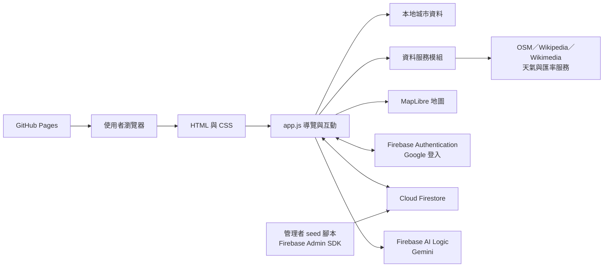

# DT-Action-App：旅遊地點分析 APP (Travel Spot Analyzer)

本專案為「設計思考與行動 APP 程式設計應用」課程之學生原型實作專案，依據使用者訪談回饋（直飛航班需求、物價查詢、避免資訊雜亂）進行規劃與迭代。

---

## 專案架構與執行邏輯

### 系統架構

本專案是以 GitHub Pages 發布的靜態前端網站，沒有自建 Node.js／Express API 伺服器。前端模組直接呼叫 Firebase 與公開資料服務；Firebase 提供登入、資料庫和 AI 服務。具有寫入權限的城市目錄匯入工作由管理者在本機執行 Firebase Admin SDK，不會在瀏覽器執行。

### 前端模組

| 路徑 | 職責 |
| --- | --- |
| `index.html` | 頁面骨架、世界／大洲／國家城市層級、工具入口及依序載入的瀏覽器腳本。 |
| `src/css/style.css` | 桌面與手機版版面、元件狀態、抽屜、地圖和行程樣式。 |
| `src/js/app.js` | 應用啟動、網址路徑、主要頁面切換、地圖互動與抽屜控制。地圖程式下載完成前，其他介面先啟動。 |
| `src/js/store/appStore.js` | 當前目的地、篩選條件、頁面路徑和地圖視角的記憶。 |
| `src/js/modules/continentView.js` | 大洲目的地卡片與篩選結果。 |
| `src/js/modules/countryView.js` | 國家／城市資訊、景點卡片、圖片、地圖定位及即時資料補充。 |
| `src/js/modules/globalCitiesView.js` | 全球城市目錄、搜尋和分批呈現。 |
| `src/js/modules/plannerView.js` | 側邊工作區中的收藏、比較、預算、行程、AI 生成及本機／雲端同步介面。 |
| `src/js/map/mapManager.js`、`geoContinents.js` | MapLibre 地圖、圖層、投影、標記和地圖上下文。 |
| `src/js/services/` | 景點、城市目錄、天氣、匯率和航班資料的請求、快取與 fallback。 |
| `src/data/` | 隨網站發布的城市、國家、座標及景點初始資料。 |
| `src/js/firebase.js`、`firebase-ai-config.js` | Firebase Web 初始化、帳戶／Firestore 雲端同步，以及 Firebase AI Logic/App Check 公開設定。 |
| `sw.js`、`manifest.json`、`src/js/pwa.js` | PWA 安裝資訊、Service Worker 更新與同源靜態資源快取。 |

### 使用者操作與資料流

1. GitHub Pages 回傳靜態 HTML、CSS、JavaScript 和內建城市資料。一般腳本以 `defer` 依文件順序執行；MapLibre 地圖程式另行非同步載入，地圖失敗不阻擋其他頁面操作。
2. 固定側欄可切換探索、全球城市、獨立行程工作區和比較抽屜；行程入口使用目前城市，若尚未選城市則回到最近造訪城市，初次使用會提示先選目的地。使用者也可由世界地圖或洲別篩選下鑽到國家／城市。網址 hash 與 Store 記錄目前層級，支援直接分享、瀏覽器上一頁／下一頁及記住地圖視角。
3. 城市頁先用內建資料呈現，再並行查詢 Firestore 公開城市目錄及 OSM／Wikipedia／Wikidata 等來源；查詢設有逾時和備援，結果會快取 7 至 14 天。景點卡片可直接開啟 Google Maps URL（不需 Google Maps API key），並從 Wikipedia／Wikimedia Commons 載入縮圖與圖片來源連結。圖片只為目前顯示的景點載入，展開更多景點時才補查其餘項目。資料服務失敗時保留可用資料、提供地圖搜尋入口及重新載入按鈕。
4. 預算、收藏、比較、最近瀏覽及行程先存在目前瀏覽器的本機儲存空間。Google 登入成功後，Firebase Auth UID 作為使用者識別，資料同步至 `users/{uid}/appData/{dataId}`；Firestore 規則只允許該 UID 存取自己的受限資料文件。
5. AI 行程由已載入的候選景點產生，Firebase AI Logic 呼叫 Gemini；App Check 使用 reCAPTCHA Enterprise 驗證應用程式。AI 不寫入公開城市目錄；使用者的行程保存仍透過個人資料同步流程。
6. Service Worker 快取同源網站殼層，以便離線開啟已下載資源；地圖底圖、Firebase 與即時外部資料仍需要網路。

### Firebase 與維運邊界

- **Authentication**：Google Popup 登入，前端不提供電子郵件／密碼登入。
- **Cloud Firestore**：`cities/{cityId}` 與 `spots` 子集合供公開讀取，瀏覽器禁止寫入；`users/{uid}/appData/{dataId}` 為個人資料，依 UID 隔離。規則來源為 `firestore.rules`，索引來源為 `firestore.indexes.json`。
- **城市目錄寫入**：`scripts/seed-city-catalog.mjs` 透過 Firebase Admin SDK 與 Application Default Credentials 執行；服務帳戶憑證不得放入網站或 Git。
- **AI 與 App Check**：`src/js/firebase-ai-config.js` 只存公開 reCAPTCHA Enterprise site key；App Check 註冊、允許網域、enforcement 與帳單狀態在 Firebase／Google Cloud Console 管理。
- **發布**：網站由 GitHub Pages 發布；Firebase 設定部署另由 Firebase CLI 執行。Firebase Hosting 設定雖保留在 `firebase.json`，不是目前網站發布管道。

相關檔案：[`Firebase 維運與發布流程`](./FIREBASE_OPERATIONS.md)、[`firestore.rules`](./firestore.rules)、[`firebase.json`](./firebase.json)、[`seed-city-catalog.mjs`](./scripts/seed-city-catalog.mjs)。雲端規則、App Check 或資料庫的實際部署狀態需在 Firebase Console 核對，不能只由本機來源檔推定。

---

## 專案核心特色

1. **互動式世界地圖**：提供世界地圖視角，支援縮放、平移與直覺點選；進入城市後會沿用同一張地圖放大至城市尺度，只顯示已編目或已定位的景點與機場標記，點擊標記可查看資訊並返回世界或上一層地圖。
2. **大洲與多維度篩選**：支援直飛篩選、預算與物價指標過濾、關鍵字即時搜尋。
3. **國家與城市深度分析**：
   - ✈️ **直飛航班情報**：清楚呈現直飛/轉機、航空公司、預估航程。
   - 💰 **當地日常物價指數**：提供日均預算、餐飲、交通與住宿估算。
   - 🏙️ **城市景點目錄**：按城市載入有座標與來源連結的地點，景點卡片可直接開啟 Google 地圖，並按需顯示 Wikipedia／Wikimedia Commons 圖片與來源。
   - 🗃️ **多來源旅遊資料**：整合可選的 OpenTripMap、Wikivoyage、Wikidata、中文 Wikipedia、Wikimedia Commons、OpenStreetMap/Nominatim 與 Open-Meteo；以多級 fallback 提供景點摘要、結構化描述、圖片、地址座標與即時天氣。
   - 🌐 **全球城市目錄**：整合 200 座去重城市，可依名稱或來源資料完整度瀏覽；每座城市開啟後先顯示基本位置與目的地資料，再載入附近地點與百科摘要。
   - 🔎 **免資料庫城市搜尋**：城市基本座標與摘要隨前端載入，點入後再以即時服務補充資料，適合原型部署與快速探索。
4. **友善容錯機制**：清晰麵包屑導航與隨時「返回／重新選擇」機制。
5. **智慧旅遊規劃工具**：
   - 🧭 依已載入且有來源的景點分類瀏覽；未取得足夠資料時不給城市評分或航班／物價推薦。
   - ⚖️ 最多四座城市比較。
   - 💰 可調整住宿、交通、餐飲與活動預算圖表。
   - 🗓️ 3／5／7 天快速行程產生器。
   - ✍️ 完整行程產生器會依每日早午晚時段安排景點、餐食、移動與備註，依城市交通特性提供地鐵／公車建議與 Google Maps 大眾運輸路線，也可指定景點加入某一天並複製或列印。
   - 🏷️ 資料來源、更新狀態與規劃參考提醒。
6. **分層式探索介面**：
   - 🧭 固定側邊導覽可切換探索、城市目錄、行程規劃與城市比較；手機版改為底部功能列。
   - 🌐 將全球城市目錄收進左側抽屜，透過名稱、資料完整度與搜尋瀏覽。
   - ⚖️ 將城市比較獨立為側邊抽屜，避免首頁資訊過度擁擠。
   - 📱 桌面版由左側滑入、手機版自動全寬，支援遮罩、Esc、鍵盤焦點與減少動畫偏好。
   - 🔍 側欄提供 80%／85%／90%／95%／100%／105%／110% 顯示比例調整，並會記住上次設定。
   - 🔗 導覽路徑會同步到網址 hash，可直接分享城市頁，並支援瀏覽器上一頁／下一頁返回探索。

---

## 2D／3D 整合地圖

互動地圖使用 MapLibre GL JS 單一 WebGL 畫布，以 globe 與 Mercator 投影切換 3D 地球和平面地圖；2D／3D 使用雙按鈕投影選擇器，城市、景點、航線和底圖風格在兩種投影中共用。全球城市目錄收錄 200 座去重城市，其中 127 座已有 GeoNames 來源座標；其餘城市在使用者開啟時，透過 OpenStreetMap Nominatim 以城市名及國家載入位置並在本機快取 180 天。新增目錄記錄及 GeoNames 來源查詢連結位於 [`cityCatalogExpansion.js`](./src/data/cityCatalogExpansion.js)；地名 ID 與座標位於 [`cityGeonames.js`](./src/data/cityGeonames.js)。城市景點會合併本地候選、Firestore 公開目錄及 OpenStreetMap、Wikidata、Wikipedia 的附近地點，來源成功取得的資料會在瀏覽器快取 14 天。若所有來源都暫時無法提供結果，城市頁和 AI 行程仍會提供清楚標示的 Google 地圖搜尋入口；這些入口是搜尋方向，不會冒充已核實的景點。物價與航班會顯示城市級即時查詢說明，不以國家平均值冒充城市價格。底圖提供 OpenFreeMap 向量地圖與 Esri World Imagery 衛星影像；圖資與按需地點查詢需要網路，瀏覽器需支援 WebGL。

Firebase 使用 compat SDK 初始化 Authentication 與 Analytics；Google 登入使用 Popup 彈出 Google 帳戶驗證視窗；若 Firebase SDK 或網域設定錯誤，帳戶選單會顯示錯誤提示。Analytics 不可用時會安全降級，不會阻止登入或地圖功能。

## 專案規格文件

- 詳細資訊架構 (IA)、UI/UX 畫面流程與 V1 ➔ V2 迭代規劃，請參閱：[`DESIGN_SPEC.md`](./DESIGN_SPEC.md)。

## 資料可靠性與目前限制

- 城市、航班與物價部分為專案整理或規劃參考資料，不代表即時航班、即時價格或官方簽證結果。
- 天氣、匯率與景點補充資料依賴外部服務；服務無法使用時，介面會保留內建資料並標示目前狀態。
- 景點圖片、百科摘要、地址與座標可能來自不同公開資料來源，更新時間與完整度可能不同。
- 前端館藏會優先讀取 Firestore 公開目錄 `cities/{cityId}` 與 `cities/{cityId}/spots/{spotId}`；訪客可讀取，瀏覽器不提供一般寫入權限。執行 `npm run seed:city-catalog` 可透過 Firebase Admin Application Default Credentials 將現有館藏匯入後台。
- GeoNames 城市地名資料以 CC BY 4.0 授權；資料來源與地名 ID 保留於城市目錄，地圖頁會顯示來源連結。
- OpenStreetMap Nominatim 僅在使用者開啟尚未有座標的城市時查詢，每個瀏覽器序列化請求並至少間隔 1.1 秒，座標快取 180 天；使用量需遵守 [Nominatim 使用政策](https://operations.osmfoundation.org/policies/nominatim/)。
- 景點補充會合併 OpenStreetMap、Wikidata 與 Wikipedia 的地理資料；資料服務無回應且沒有本地景點候選時，改顯示標示清楚的地圖搜尋入口，不推測單一景點或座標。
- 百科與圖片補充請求透過前端佇列限制併發；公開服務可能限流或暫時無法使用，缺資料時不會用近似座標代替景點位置。
- 使用前端快取資料時，請以畫面上的來源標示及服務提供者最新資訊為準。
- 目前專案為無建置工具的原型，正式發布前仍應補上瀏覽器操作測試、JavaScript 語法檢查與部署驗證。
- 已加入 PWA manifest 與 Service Worker；需透過 HTTP(S) 部署後才會啟用安裝與離線殼層，直接以 `file://` 開啟時會維持一般預覽模式。
- 頁面會即時提示目前是否離線；離線時仍可使用已保存的比較清單、預算與行程，重新連線後可再次取得外部資料。
- 首頁會保留最近瀏覽的城市；城市與景點詳情頁也可加入收藏，資料會保存於目前裝置的瀏覽器中。

## Firebase Analytics 與帳戶登入

Firebase 初始化與 Web SDK 設定位於 [`src/js/firebase.js`](./src/js/firebase.js)，並以一般延遲載入的瀏覽器腳本載入 Firebase Compat SDK，避免 ES module 在本機檔案預覽時遭瀏覽器 CORS 阻擋。頁面開啟、主要導覽及登入相關事件會以 Firebase Analytics 記錄；帳戶登入使用 Firebase Authentication，登入狀態預設保存在瀏覽器本機。Firebase Web SDK 的 API key 與專案識別資料是前端公開設定，請勿在前端放置服務帳戶金鑰或私密憑證。

### 登入功能

頁面右上角的帳戶選單只提供 Google 登入。按下「使用 Google 帳戶登入」會直接開啟 Google 帳戶驗證視窗，不需要在網站輸入電子郵件或密碼。

### Firebase Console 必要設定

1. 確認 Web App 的 Firebase 設定與 `src/js/firebase.js` 中 `firebaseConfig` 相符。
2. 在 **Authentication → Sign-in method** 啟用 **Google**。如登入回報 `auth/operation-not-allowed`，請在此頁確認 Google 提供者已啟用。
3. 在 **Authentication → Settings → Authorized domains** 加入 `trilobitexz.github.io`（GitHub Pages 的自訂專案網址只需加入主機名稱，不要加 `https://` 或 `/DT-Action-App/`）。本機測試使用 `localhost`。
4. 確認 Google 登入提供者的支援電子郵件與 OAuth 設定已完成。
5. 本專案正式網站使用 GitHub Pages；Firebase Hosting 並非登入必要條件。

## 登入與 Firestore 雲端同步

Firebase Authentication 前端登入使用 Google（不含 LINE，也不顯示電子郵件／密碼登入表單）。本機程式預期使用 Firestore Standard；實際資料庫版本與位置請在 Firebase Console 核對。登入後，城市收藏、比較清單、最近瀏覽、預算與行程會同步至 `users/{uid}/appData/{dataId}`；部署本機規則後，每位使用者只能讀寫自己的資料。資料仍會保留在本機，網路／規則問題時會在帳戶選單顯示同步狀態。

Firestore 安全規則位於 [`firestore.rules`](./firestore.rules)，僅允許指定應用資料文件與受限 JSON 字串大小。雲端是否已部署需在 Firebase Console 核對；可依照 [`Firebase 維運與發布流程`](./FIREBASE_OPERATIONS.md) 部署 Authentication／Firestore 設定並完成發布檢查。Firebase Hosting 設定保留於 `firebase.json`，但目前網站發布由 GitHub Pages 負責。

## AI 旅程規劃

城市規劃工具新增 AI 行程規劃，可依旅行天數、交通方式與旅客偏好，從已載入的城市景點安排每日順序；景點不足時會查詢周邊公開資料，資料來源暫時無回應時仍會提供地圖搜尋入口。結果可拖曳調整，沿用既有行程保存與登入後的 Firestore 同步。模型使用 Firebase AI Logic（Gemini Developer API）與 Gemini 3.8 Flash，輸出以結構化 JSON 驗證，避免模型捏造清單以外的景點。

首次使用前，請依照 [`Firebase 維運與發布流程`](./FIREBASE_OPERATIONS.md) 在 Firebase Console 註冊 App Check reCAPTCHA Enterprise Web App，並確認 GitHub Pages 網域列入允許清單。網站金鑰已放在 `src/js/firebase-ai-config.js`，屬公開識別碼；不要放入 reCAPTCHA secret key 或 App Check debug token。先確認有效 token，再於 Console 逐步啟用 Firebase AI Logic enforcement。
