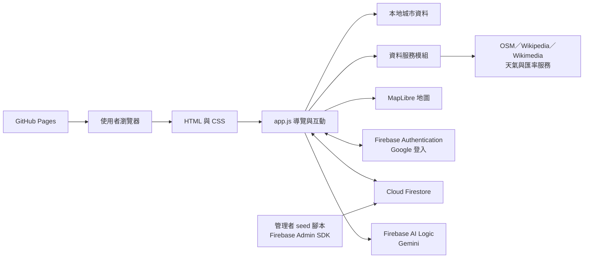

# journey-atla：旅途指南 (Journey Atlas)

本專案為「設計思考與行動 APP 程式設計應用」課程之學生原型實作專案，依據使用者訪談回饋（直飛航班需求、物價查詢、避免資訊雜亂）進行規劃與迭代。

---

## 專案架構與執行邏輯

### 發布版本命名規則

- 每次 GitHub Pages 發布使用一個全站版本號 `vN`；本次為 `v114`，下一次發布時統一遞增為 `v115`。
- 所有本地 CSS、JavaScript、城市資料、景點 JSON、manifest 與圖示的快取查詢參數使用相同的 `?v=N`，並在 `index.html`、`sw.js` 與程式內的動態靜態資料 URL 保持一致。
- Service Worker 快取名稱使用 `journey-atlas-shell-vN`，與資源參數和發布提交訊息中的版本一致。更新 HTML 資源參數時，必須同步更新 Service Worker 的預快取清單及快取名稱。
- 外部 CDN／API 使用供應商版本或 API URL，不改成專案版號；`index.html` 與 `sw.js` 自身不加查詢參數，避免影響導覽快取與 Service Worker 更新檢查。

### 系統架構

本專案是以 GitHub Pages 發布的靜態前端網站，沒有自建 Node.js／Express API 伺服器。前端模組直接呼叫 Firebase 與公開資料服務；Firebase 提供登入、資料庫和 AI 服務。具有寫入權限的城市目錄匯入工作由管理者在本機執行 Firebase Admin SDK，不會在瀏覽器執行。

### 前端模組

| 路徑 | 職責 |
| --- | --- |
| `index.html` | 頁面骨架、世界／大洲／國家城市層級、工具入口及依序載入的瀏覽器腳本。 |
| `src/css/style.css` | 桌面與手機版版面、元件狀態、抽屜、地圖和行程樣式。 |
| `src/js/app.js` | 應用啟動、網址路徑、主要頁面切換、地圖互動與抽屜控制。地圖程式下載完成前，其他介面先啟動。 |
| `src/js/store/appStore.js` | 當前目的地、篩選條件、頁面路徑和地圖視角的記憶。 |
| `src/js/modules/continentView.js` | 大洲目的地卡片與篩選結果。 |
| `src/js/modules/countryView.js` | 國家／城市資訊、景點卡片、圖片、地圖定位及即時資料補充。 |
| `src/js/modules/globalCitiesView.js` | 全球城市目錄、搜尋和分批呈現。 |
| `src/js/modules/plannerView.js` | 側邊工作區中的收藏、比較、預算、行程、AI 生成及本機／雲端同步介面。 |
| `src/js/modules/worldHighlightsView.js` | 世界之最策展名錄：古今奇蹟、三大博物館、古文明、自然奇觀、七大洲高峰、北美五大湖及世界遺產代表地，可搜尋、收藏、查看詳情與定位地圖。 |
| `src/js/map/mapManager.js`、`geoContinents.js` | MapLibre 地圖、圖層、投影、標記和地圖上下文。 |
| `src/js/services/` | 景點、城市目錄、天氣、匯率、航班、國家行前資訊、歷史氣候及道路路線請求、快取與 fallback。 |
| `src/data/` | 隨網站發布的城市、國家、座標及景點初始資料。 |
| `src/js/firebase.js`、`firebase-ai-config.js` | Firebase Web 初始化、帳戶／Firestore 雲端同步，以及 Firebase AI Logic/App Check 公開設定。 |
| `sw.js`、`manifest.json`、`src/js/pwa.js` | PWA 安裝資訊、Service Worker 更新與同源靜態資源快取。 |

### 使用者操作與資料流

1. GitHub Pages 回傳靜態 HTML、CSS、JavaScript 和內建城市資料。一般腳本以 `defer` 依文件順序執行；MapLibre 地圖程式另行非同步載入，地圖失敗不阻擋其他頁面操作。桌面側欄可收合並記住選擇，窄螢幕改用圖示導覽或底部功能列。
2. 固定側欄可切換探索、全球城市、獨立行程工作區和比較抽屜；行程入口使用目前城市，若尚未選城市則回到最近造訪城市，初次使用會提示先選目的地。使用者也可由世界地圖或洲別篩選下鑽到國家／城市。網址 hash 與 Store 記錄目前層級，支援直接分享、瀏覽器上一頁／下一頁及記住地圖視角。
3. 城市頁先用內建資料呈現，再並行查詢 Firestore 公開城市目錄及 OSM／Wikipedia／Wikidata 等來源；景點依明確精選標記、來源與座標完整度排序，同等資料品質保留資料庫順序。查詢設有逾時和備援，結果會快取 7 至 14 天。景點卡片可直接開啟 Google Maps URL（不需 Google Maps API key），並從 Wikipedia／Wikimedia Commons 載入縮圖與圖片來源連結。圖片只為目前顯示的景點載入，展開更多景點時才補查其餘項目。資料服務失敗時保留可用資料、提供地圖搜尋入口及重新載入按鈕。
4. 預算、收藏、比較、最近瀏覽及行程先存在目前瀏覽器的本機儲存空間。Google 登入成功後，Firebase Auth UID 作為使用者識別，資料同步至 `users/{uid}/appData/{dataId}`；Firestore 規則只允許該 UID 存取自己的受限資料文件。
5. AI 行程由已載入的候選景點產生，Firebase AI Logic 呼叫 Gemini；App Check 使用 reCAPTCHA Enterprise 驗證應用程式。AI 不寫入公開城市目錄；使用者的行程保存仍透過個人資料同步流程。
6. Service Worker 快取同源網站殼層，以便離線開啟已下載資源；地圖底圖、Firebase 與即時外部資料仍需要網路。

### 新增公開資料來源與降級方式

- **REST Countries** 提供官方語言、時區、駕駛方向與國際電話區碼；國家名稱無法匹配或服務逾時時，保留既有國家與城市資料。
- **Nager.Date** 依選定出發日提示全國國定假日；不涵蓋地方節日，服務不可用時提醒使用者查官方公告。
- **Open-Meteo Historical Weather API** 以最近十個完整年度的逐日資料計算 1–12 月平均氣溫與月降雨量；這是氣候參考，不是天氣預報。城市座標無效或服務失敗時不顯示氣候卡。
- **OSRM 公開示範路由服務** 僅在行程交通方式選擇「開車」時查詢道路路線，並在目前開啟的行程日顯示道路距離與預估駕車時間；同一組座標的地圖與行程查詢共用請求及快取。逾時、無路徑或服務不可用時保留地圖上的虛線行程示意。距離與時間不含即時路況保證。公開服務有使用政策與容量限制，不應大量或高頻請求。
- 上述服務均由瀏覽器直接呼叫並設有逾時處理，非本專案自營 API；可用性、涵蓋範圍、資料更新及服務條款依各提供者為準。
- **世界之最名錄** 是方便探索的策展清單；古代奇蹟部分標記為近似位置，新世界七大奇蹟與七大自然奇觀採 New7Wonders 民間票選名單，三大博物館不代表官方排名，七大洲高峰採 Messner 版本，古文明遺址與世界遺產代表地均非完整名單。清單提供來源連結，位置按下「地圖定位」後會飛往互動地圖。

### Firebase 與維運邊界

- **Authentication**：Google Popup 登入，前端不提供電子郵件／密碼登入。
- **Cloud Firestore**：`cities/{cityId}` 與 `spots` 子集合供公開讀取，瀏覽器禁止寫入；`users/{uid}/appData/{dataId}` 為個人資料，依 UID 隔離。規則來源為 `firestore.rules`，索引來源為 `firestore.indexes.json`。
- **城市目錄寫入**：`scripts/seed-city-catalog.mjs` 透過 Firebase Admin SDK 與 Application Default Credentials 執行；服務帳戶憑證不得放入網站或 Git。
- **AI 與 App Check**：`src/js/firebase-ai-config.js` 只存公開 reCAPTCHA Enterprise site key；App Check 註冊、允許網域、enforcement 與帳單狀態在 Firebase／Google Cloud Console 管理。
- **發布**：網站由 GitHub Pages 發布；Firebase 設定部署另由 Firebase CLI 執行。Firebase Hosting 設定雖保留在 `firebase.json`，不是目前網站發布管道。

相關檔案：[`Firebase 維運與發布流程`](./FIREBASE_OPERATIONS.md)、[`firestore.rules`](./firestore.rules)、[`firebase.json`](./firebase.json)、[`seed-city-catalog.mjs`](./scripts/seed-city-catalog.mjs)。雲端規則、App Check 或資料庫的實際部署狀態需在 Firebase Console 核對，不能只由本機來源檔推定。

---

## 專案核心特色

1. **互動式世界地圖**：提供世界地圖視角，支援縮放、平移與直覺點選；全球城市使用 MapLibre GeoJSON 群聚，縮放後逐步顯示單一城市及標籤。進入城市後沿用同一張地圖放大至城市尺度，最多呈現 100 個有效座標景點與機場；標記密度會隨縮放調整，點擊標記可在地圖內查看資訊。
2. **大洲與多維度篩選**：支援直飛篩選、預算與物價指標過濾、關鍵字即時搜尋。
3. **國家與城市深度分析**：
   - ✈️ **直飛航班情報**：清楚呈現直飛/轉機、航空公司、預估航程。
   - 💰 **當地日常物價指數**：提供日均預算、餐飲、交通與住宿估算。
   - 🏙️ **城市景點目錄**：按城市載入有座標與來源連結的地點，景點卡片可直接開啟 Google 地圖，並按需顯示 Wikipedia／Wikimedia Commons 圖片與來源。
   - 🗃️ **多來源旅遊資料**：整合可選的 OpenTripMap、Wikivoyage、Wikidata、中文 Wikipedia、Wikimedia Commons、OpenStreetMap/Nominatim 與 Open-Meteo；以多級 fallback 提供景點摘要、結構化描述、圖片、地址座標、天氣及空氣品質估值。空氣品質使用 Open-Meteo Air Quality API 的全球模式資料，會標示為估值而非測站即時讀值，並保留來源時間與快取狀態。
   - 🌐 **全球城市目錄**：整合 200 座去重城市，可依名稱或來源資料完整度瀏覽；每座城市開啟後先顯示基本位置與目的地資料，再載入附近地點與百科摘要。
   - 🔎 **免資料庫城市搜尋**：城市基本座標與摘要隨前端載入，點入後再以即時服務補充資料，適合原型部署與快速探索。
4. **友善容錯機制**：清晰麵包屑導航與隨時「返回／重新選擇」機制。
5. **智慧旅遊規劃工具**：
   - 🧭 依已載入且有來源的景點分類瀏覽；未取得足夠資料時不給城市評分或航班／物價推薦。
   - ⚖️ 最多四座城市比較。
   - 💰 由使用者輸入住宿、交通、餐飲與活動預算；資料不完整時不預填城市金額，總額與每日平均按使用者輸入及所選天數計算。
   - 🗓️ 3／5／7 天快速行程產生器。
   - ✍️ 完整行程產生器會依每日早午晚時段安排景點、餐食、移動與備註，依城市交通特性提供地鐵／公車建議與 Google Maps 大眾運輸路線，也可指定景點加入某一天並複製或列印。
   - 🏷️ 資料來源、更新狀態與規劃參考提醒。
6. **分層式探索介面**：
   - 🧭 固定側邊導覽可切換探索、城市目錄、行程規劃與城市比較；手機版改為底部功能列。
   - 🌐 將全球城市目錄收進左側抽屜，透過名稱、資料完整度與搜尋瀏覽。
   - ⚖️ 將城市比較獨立為側邊抽屜，避免首頁資訊過度擁擠。
   - 📱 桌面版由左側滑入、手機版自動全寬，支援遮罩、Esc、鍵盤焦點與減少動畫偏好。
   - 🔍 側欄支援桌面滑鼠懸停展開與手機點擊展開，並保留鍵盤操作及焦點狀態。
   - 🔗 導覽路徑會同步到網址 hash，可直接分享城市頁，並支援瀏覽器上一頁／下一頁返回探索。

---

## 2D／3D 整合地圖

互動地圖使用 MapLibre GL JS 單一 WebGL 畫布，以 globe 與 Mercator 投影切換 3D 地球和平面地圖；2D／3D 使用雙按鈕投影選擇器，城市、景點、航線和底圖風格在兩種投影中共用。全球城市目錄收錄 200 座去重城市，其中 127 座已有 GeoNames 來源座標；其餘城市在使用者開啟時，透過 OpenStreetMap Nominatim 以城市名及國家載入位置並在本機快取 180 天。新增目錄記錄及 GeoNames 來源查詢連結位於 [`cityCatalogExpansion.js`](./src/data/cityCatalogExpansion.js)；地名 ID 與座標位於 [`cityGeonames.js`](./src/data/cityGeonames.js)。城市景點會合併本地候選、Firestore 公開目錄及 OpenStreetMap、Wikidata、Wikipedia 的附近地點，來源成功取得的資料會在瀏覽器快取 14 天。若所有來源都暫時無法提供結果，城市頁和 AI 行程仍會提供清楚標示的 Google 地圖搜尋入口；這些入口是搜尋方向，不會冒充已核實的景點。物價與航班會顯示城市級即時查詢說明，不以國家平均值冒充城市價格。底圖提供 OpenFreeMap 向量地圖與 Esri World Imagery 衛星影像；圖資與按需地點查詢需要網路，瀏覽器需支援 WebGL。

城市地圖中的景點、機場、市中心、行程站點與路線皆可點擊查看說明；向量底圖上有名稱的地點與建築也可點擊，未標名處會以座標開啟 Google Maps／OpenStreetMap 搜尋入口。底圖位置屬探索線索，實際地址、營業狀態與交通資訊請以外部來源確認。

Firebase 使用 compat SDK 初始化 Authentication 與 Analytics；Google 登入使用 Popup 彈出 Google 帳戶驗證視窗；若 Firebase SDK 或網域設定錯誤，帳戶選單會顯示錯誤提示。Analytics 不可用時會安全降級，不會阻止登入或地圖功能。

## 專案規格文件

- 詳細資訊架構 (IA)、UI/UX 畫面流程與 V1 ➔ V2 迭代規劃，請參閱：[`DESIGN_SPEC.md`](./DESIGN_SPEC.md)。

## 資料可靠性與目前限制

### 評分與費用呈現原則

- 景點星等只有在同時具備 0–5 範圍的數值與評分來源時才顯示；缺任一項時顯示「評分資料未提供」，不以模型或編輯者印象補分。
- 城市目錄以 `isFeatured`／`featuredRank` 優先，接著優先有來源連結及座標的資料，最後依既有來源順序呈現。景點卡首屏顯示五筆，其餘按需展開；地圖最多載入 100 個有效座標景點，並隨縮放調整標記密度。超出城市中心 50 公里的可疑座標不會畫成該城市的景點標記，仍可改用 Google 地圖搜尋。
- 內建國家級物價範圍是概略規劃資料，不是城市排名、統計分數或即時報價；日期、地區、匯率和消費方式都會造成差異。預算工具因此不預填通用金額，只加總使用者輸入的項目並除以行程天數。
- 若要把物價升級成可比較的城市估值，資料必須帶有來源、幣別、採樣日期、住宿／餐飲等級及區域；在這些欄位齊備前不產生城市物價分數。

- 城市、航班與物價部分為專案整理或規劃參考資料，不代表即時航班、即時價格或官方簽證結果。
- 天氣、匯率與景點補充資料依賴外部服務；服務無法使用時，介面會保留內建資料並標示目前狀態。
- 景點圖片、百科摘要、地址與座標可能來自不同公開資料來源，更新時間與完整度可能不同。
- 前端館藏會優先讀取 Firestore 公開目錄 `cities/{cityId}` 與 `cities/{cityId}/spots/{spotId}`；訪客可讀取，瀏覽器不提供一般寫入權限。城市景點離線資料由 `npm run enrich:city-spots` 產生，再執行 `npm run seed:city-catalog` 透過 Firebase Admin Application Default Credentials 匯入。
- GeoNames 城市地名資料以 CC BY 4.0 授權；資料來源與地名 ID 保留於城市目錄，地圖頁會顯示來源連結。
- OpenStreetMap Nominatim 僅在使用者開啟尚未有座標的城市時查詢，每個瀏覽器序列化請求並至少間隔 1.1 秒，座標快取 180 天；使用量需遵守 [Nominatim 使用政策](https://operations.osmfoundation.org/policies/nominatim/)。
- 景點補充會合併 OpenStreetMap、Wikidata 與 Wikipedia 的地理資料；資料服務無回應且沒有本地景點候選時，改顯示標示清楚的地圖搜尋入口，不推測單一景點或座標。
- 百科與圖片補充請求透過前端佇列限制併發；公開服務可能限流或暫時無法使用，缺資料時不會用近似座標代替景點位置。
- 使用前端快取資料時，請以畫面上的來源標示及服務提供者最新資訊為準。
- 專案維持無建置工具的 Vanilla 前端。每次發布依 [`QA_CHECKLIST.md`](./QA_CHECKLIST.md) 檢查主要桌面／手機流程、服務失敗降級、Firestore 規則和 Service Worker 快取；Firebase Console 實際部署狀態仍需在 Console 核實。
- 已加入 PWA manifest 與 Service Worker；需透過 HTTP(S) 部署後才會啟用安裝與離線殼層，直接以 `file://` 開啟時會維持一般預覽模式。
- 頁面會即時提示目前是否離線；離線時仍可使用已保存的比較清單、預算與行程，重新連線後可再次取得外部資料。
- 首頁會保留最近瀏覽的城市；城市與景點詳情頁也可加入收藏，資料會保存於目前裝置的瀏覽器中。

## Firebase Analytics 與帳戶登入

Firebase 初始化與 Web SDK 設定位於 [`src/js/firebase.js`](./src/js/firebase.js)，並以一般延遲載入的瀏覽器腳本載入 Firebase Compat SDK，避免 ES module 在本機檔案預覽時遭瀏覽器 CORS 阻擋。頁面開啟、主要導覽及登入相關事件會以 Firebase Analytics 記錄；帳戶登入使用 Firebase Authentication，登入狀態預設保存在瀏覽器本機。Firebase Web SDK 的 API key 與專案識別資料是前端公開設定，請勿在前端放置服務帳戶金鑰或私密憑證。

### 登入功能

頁面右上角的帳戶選單只提供 Google 登入。按下「使用 Google 帳戶登入」會直接開啟 Google 帳戶驗證視窗，不需要在網站輸入電子郵件或密碼。

### Firebase Console 必要設定

1. 確認 Web App 的 Firebase 設定與 `src/js/firebase.js` 中 `firebaseConfig` 相符。
2. 在 **Authentication → Sign-in method** 啟用 **Google**。如登入回報 `auth/operation-not-allowed`，請在此頁確認 Google 提供者已啟用。
3. 在 **Authentication → Settings → Authorized domains** 加入 `trilobitexz.github.io`（GitHub Pages 的專案網址路徑會隨儲存庫名稱變更，例如 `/journey-atla/`；授權網域只填主機名稱，不要加 `https://` 或路徑）。本機測試使用 `localhost`。
4. 確認 Google 登入提供者的支援電子郵件與 OAuth 設定已完成。
5. 本專案正式網站使用 GitHub Pages；Firebase Hosting 並非登入必要條件。

## 登入與 Firestore 雲端同步

Firebase Authentication 前端登入使用 Google（不含 LINE，也不顯示電子郵件／密碼登入表單）。本機程式預期使用 Firestore Standard；實際資料庫版本與位置請在 Firebase Console 核對。登入後，城市收藏、比較清單、最近瀏覽、預算與行程會同步至 `users/{uid}/appData/{dataId}`；部署本機規則後，每位使用者只能讀寫自己的資料。資料仍會保留在本機，網路／規則問題時會在帳戶選單顯示同步狀態。

Firestore 安全規則位於 [`firestore.rules`](./firestore.rules)，僅允許指定應用資料文件與受限 JSON 字串大小。雲端是否已部署需在 Firebase Console 核對；可依照 [`Firebase 維運與發布流程`](./FIREBASE_OPERATIONS.md) 部署 Authentication／Firestore 設定並完成發布檢查。Firebase Hosting 設定保留於 `firebase.json`，但目前網站發布由 GitHub Pages 負責。

### 城市景點離線補齊與匯入

1. 在具備網路的管理者電腦執行 `npm run enrich:city-spots`（或 `node scripts/enrich-city-spots.mjs`）。腳本讀取前端 200 座去重城市，沿用內建 GeoNames 座標，缺座標時依 Nominatim 政策以至少 1.1 秒間隔查詢；先查中文 Wikipedia geosearch，不足三筆再查英文 Wikipedia 與 Wikidata，篩出 50 公里內具來源網址與合法座標的景點。若只想重試上次未達三筆的城市，可加 `--retry-incomplete`。
2. 腳本產生 `scripts/data/prebuilt-spots.json`，並列出成功城市數及不足三筆的城市。公開資料不足時不會捏造景點；必須人工檢查缺漏，預設匯入會拒絕未達至少 200 城市、每城三筆或座標驗證不通過的資料。
3. 檢查統計後執行 `npm run seed:city-catalog`（或 `node scripts/seed-city-catalog.mjs`）。需安裝專案依賴，並以 `gcloud auth application-default login` 設定管理者 ADC，確認帳號有目標 Firebase 專案的 Firestore 寫入權限。匯入腳本會先完整驗證 JSON，再以最多 400 筆操作的 Firestore `writeBatch` 寫入；固定文件 ID 允許修正資料後安全重跑。
4. 執行 `npm run verify:city-catalog`（或 `node scripts/verify-city-catalog.mjs`）從 Firestore 回讀全部城市文件與景點子集合，逐筆驗證座標、來源、50 公里範圍與至少三筆景點。只有回讀驗證成功，才可判定資料庫匯入完成。
5. 前端進入城市頁時先讀 Firestore 子集合；有效景點到達即更新卡片和 MapLibre 標記，並依標記 bounds 調整視野。地圖仍需網路載入底圖；公開資料、Nominatim 回應和服務可用度無法保證每次都能取得三筆百科景點，因此以產生報告與匯入前驗證為準。

## AI 旅程規劃

城市規劃工具新增 AI 行程規劃，可依旅行天數、交通方式與旅客偏好，從已載入的城市景點安排每日順序；景點不足時會查詢周邊公開資料，資料來源暫時無回應時仍會提供地圖搜尋入口。結果可拖曳調整，沿用既有行程保存與登入後的 Firestore 同步。模型使用 Firebase AI Logic（Gemini Developer API）與 Gemini 3.8 Flash，輸出以結構化 JSON 驗證，避免模型捏造清單以外的景點。

首次使用前，請依照 [`Firebase 維運與發布流程`](./FIREBASE_OPERATIONS.md) 在 Firebase Console 註冊 App Check reCAPTCHA Enterprise Web App，並確認 GitHub Pages 網域列入允許清單。網站金鑰已放在 `src/js/firebase-ai-config.js`，屬公開識別碼；不要放入 reCAPTCHA secret key 或 App Check debug token。先確認有效 token，再於 Console 逐步啟用 Firebase AI Logic enforcement。

### v101 城市資料可用性呈現

- 城市資料面板保留原有 10 項欄位覆蓋算法，並額外列出有來源座標、圖片、介紹、可核實評分及營業時間的景點筆數；這些統計不計入分數，避免把資料量誤作旅遊品質。
- 資料來源沒有一致的更新時間欄位，因此介面明確標示更新日期未完整提供；不對缺值評分、營業時間或資料新鮮度做推估。

### v102 景點內容品質守門

- 新增 `node scripts/audit-city-spots.mjs` 離線稽核命令，統計缺圖片、短介紹、無效座標、缺來源，並列出疑似事件條目與行政區／教育機構名稱供人工複核。
- 已從離線城市精選資料移除金沙薩空難、奈洛比商場恐攻、泗水軍事行動及聖托里尼火山爆發事件條目；前端也會在景點卡、地圖和 AI 行程入口排除明確事件型百科條目。
- 開羅塔介紹改為景點資訊並引用開羅市政府來源；開放時間與票價仍不做推測。
- 最新離線稽核：596 筆景點；44 筆無圖片、4 筆介紹少於 40 字、座標與來源缺漏均為 0；7 筆行政區或教育機構項目列人工複核。

### v103 AI 精選行程與城市景點快取

- AI 由每一天數量乘以 2 的小清單改為從品質排序後的候選池挑選，最多 24 筆；每天 1–3 個景點，允許保留未安排候選，並驗證索引、重複景點及每日數量。
- 相同城市、日期、偏好、交通方式與候選資料的 AI 結果在此裝置快取 7 天；介面會說明候選與已安排數量，未採用的景點仍可從手動新增清單挑選。
- 城市景點資料改用 IndexedDB 保存，最多保留最近使用的 40 座城市；以 14 天作為新鮮門檻，180 天內的較舊資料仍可離線呈現並標示日期／來源，再背景查詢更新。舊 localStorage 快取會在 IndexedDB 可用後遷移並移除。
- 精選 JSON 請求版本改由 cityCatalogService.js 的載入版本自動取得，避免 Service Worker 預快取與前端載入版本脫節。
